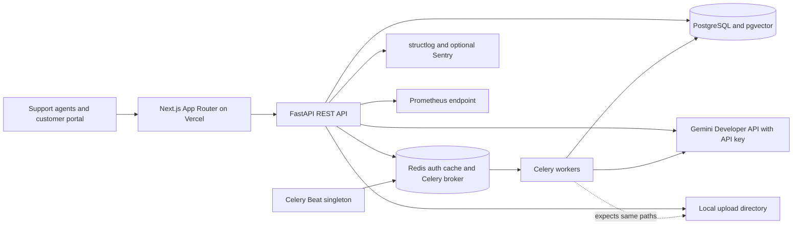

# Current SupportDesk architecture

The active application is Next.js and FastAPI over PostgreSQL/pgvector with Redis and Celery. The root README describes an older implementation. Use `render.yaml`, `src/main.py`, `src/core/factory.py` and the Python routers as the current backend reference.

## Repository map

| Path | Responsibility |
| --- | --- |
| `support-portal-frontend/app/admin/` | Dashboard, tickets, AI, customers, workforce, knowledge, documents, routing and integrations |
| `support-portal-frontend/app/(portal)/` | Customer knowledge, tickets, assistant, profile and authentication |
| `support-portal-frontend/app/(public)/` | Login, signup, verification and password recovery |
| `support-portal-frontend/components/` | Existing sidebars, ticket forms, modals and controls |
| `support-portal-frontend/utils/axiosInstance.js` | API base URL, bearer auth and refresh handling |
| `support-portal-backend/src/api/v1/` | Domain endpoints, Pydantic inputs and authorization dependencies |
| `support-portal-backend/src/services/` | Business operations, provider calls, vector retrieval and local storage |
| `support-portal-backend/src/repositories/` | Persistence queries and reusable CRUD conventions |
| `support-portal-backend/src/models.py` | Shared declarative SQLAlchemy models and enums |
| `support-portal-backend/src/core/` | Settings, database, permissions, auth, Redis and Celery setup |
| `support-portal-backend/src/workers/` | Document and KB ingestion, routing, analytics and webhooks |
| `support-portal-backend/alembic/versions/` | 18 migrations, one head `c1a8f9b2d4e6` |
| `support-portal-backend/evals/` | 12-case mocked copilot regression runner and dataset |
| `.github/workflows/` | Backend/frontend lint, backend tests, container scans and SSH/GHCR deployment |
| `render.yaml` | API plus Celery worker and singleton scheduler |
| `docker-compose*.yml`, `nginx/`, `monitoring/` | Alternative container deployment and monitoring configuration |

The frontend uses `.js`/`.jsx`, Tailwind, Recharts, Lucide and an existing Axios client. Do not assume an established TypeScript build or introduce a second charting library. Python modules use `src/`; adding a parallel `app/` tree would create unnecessary duplication.

## Existing flows

Ticket creation writes the organization-scoped ticket and submits routing. Routing classifies with Gemini, applies organization rules, ranks agents using capacity/skills/availability, updates assignment and records decisions. SLA checks run every 15 minutes through Beat; analytics aggregation runs daily.

Document upload writes a local file and submits a Celery task. The worker parses, chunks and embeds content into `KnowledgeVector`. Retrieval filters vector organization, published non-deleted KB articles and completed non-deleted documents. It uses pgvector L2 distance in PostgreSQL and Python distance computation in SQLite tests. Existing vector width is 768, with an HNSW migration.

Ticket drafts read tenant-scoped tickets and public conversation threads, retrieve evidence, generate a draft and persist `AISuggestion`. The human action endpoint records accept/edit/reject. Conversation chat persists sessions and messages but `ask()` uses the current question and retrieved context, without incorporating previous messages into the generation prompt. It has no controlled ticket/analytics tool layer or response streaming.

## Deployment differences to preserve explicitly

Render starts the API with `alembic upgrade head` and Uvicorn, and has separate worker and Beat processes. Docker production configuration uses Nginx and PostgreSQL/Redis services. GitHub deployment currently publishes GHCR images and deploys over SSH; it is not a Cloud Run workflow. `render.yaml` and settings disagree on the embedding model, which must be resolved before reindexing. No GCP Terraform or Vertex authentication path exists in the reviewed tree.

Models already include `AISuggestion`, `AIChatSession`, `AIChatMessage`, `AutomationRule`, `WorkflowExecution`, `RoutingDecision`, `AssignmentHistory`, `EventLog`, `AnalyticsSnapshot`, `KBArticleVersion`, customer and workforce entities. Extend these where appropriate rather than recreating those capabilities.
