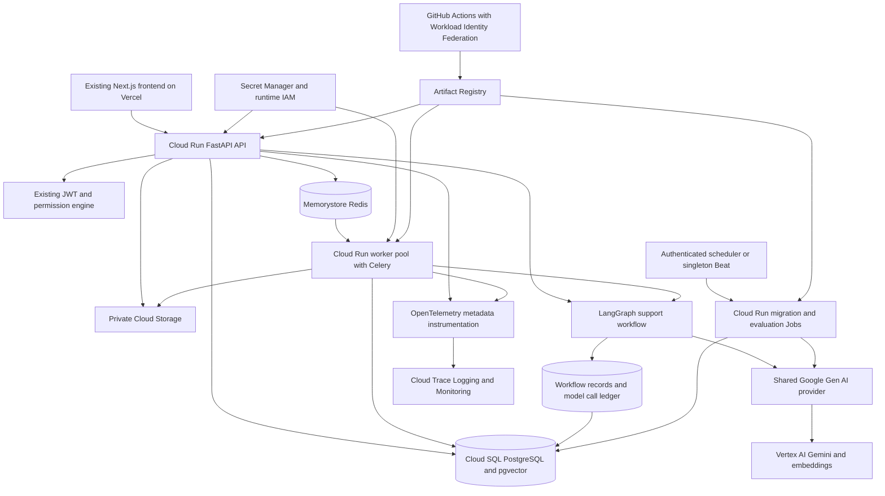
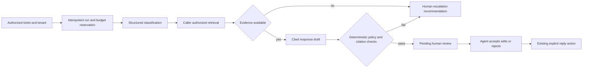

# SupportDesk target architecture and feature gaps

This is the proposed implementation, pending the Phase 0 review. SupportDesk remains a multi-tenant helpdesk. Overview and tickets remain the primary experience; AI Insights is an administrative supporting area. No existing authentication or ticket state machine is replaced.

## Google Cloud target

Use a worker pool for continuous Celery consumption where the chosen region supports it. Do not deploy a bare non-HTTP Celery process as an ordinary request-driven service. Initially keep the existing worker/scheduler during API canary deployment if that reduces migration risk. Baseline worker-pool capacity is an explicit cost decision; CPU autoscaling is currently documented as Preview. Verify launch stage and region again at deployment. See [Cloud Run worker pools](https://docs.cloud.google.com/run/docs/deploy-worker-pools) and [CPU autoscaling](https://docs.cloud.google.com/run/docs/configuring/workerpools/cpu-autoscaling).

Cloud Run's disposable filesystem makes Cloud Storage a migration prerequisite. Model IDs, locations and prices remain configuration, verified in the selected project before rollout. Use the supported [Google Gen AI SDK](https://cloud.google.com/vertex-ai/generative-ai/docs/sdks/overview); do not introduce a deprecated Vertex generation SDK as an intermediate step.

## AI execution contract

LangGraph state carries organization, actor, ticket, run and trace IDs; prompt version; structured classification; source IDs; draft; deterministic findings; and failure status. Raw text stays out of trace attributes. Nodes reuse existing retrieval and ticket services behind permission-aware adapters. Never expose arbitrary SQL or unrestricted action tools.

Proposed initial limits: 45-second workflow deadline, 15-second provider-attempt deadline, three generation attempts plus one query embedding attempt across the entire workflow, bounded input/output tokens and bounded retrieved context. Classification and response normally use one generation attempt each; transient retries consume the shared cap. Document embedding and offline evaluation have independent explicit budgets. Tune limits from measurements. An API timeout must cancel or persist a terminal/recoverable state, never silently leave a free-running thread.

Every outbound provider attempt receives its own ID and accounting state, including timeouts and missing usage. Human approval is mandatory before any customer reply. Classification and escalation recommendations do not silently override authorized ticket transitions.

## Product feature specifications

| Feature | Existing foundation | Change and acceptance criteria |
| --- | --- | --- |
| Shell | Admin/customer layouts, sidebar and Axios | Shared white/blue-gray surfaces, blue actions, violet AI accents, compact typography, 8–12px radius. Preserve routes, replace terminal vocabulary. Search returns authorized tickets/articles; organization control only offers memberships actually supported by backend. No decorative dead buttons. |
| Support overview | Recharts and analytics API | Real counts, date-filtered trends/distributions, unassigned workload, SLA due/breached, recent activity and AI assistance. First response derives from first public agent reply. CSAT is unavailable until survey data exists. Empty/error/loading and keyboard states required. |
| Tickets | State machine, conversations, timeline, bulk and merge | Preserve existing actions. Add saved filters, similar/duplicate suggestions, classification and sentiment, summary, mentions and linking incrementally. No automatic merge; verify both tickets belong to tenant. Three-column layout collapses on small screens. |
| Ticket assistant | Draft and review actions | Vertex-backed classification, retrieval and draft in LangGraph; validated citation IDs, missing-information and escalation recommendations. Show source links, measured usage/latency and explicit failure states. Acceptance does not send a reply. |
| Conversational assistant | Sessions and messages | Bounded history plus authorized read-only ticket lookup, knowledge search and support aggregate tools. Stream structured status events and final text; support cancel/retry and feedback. Translation/tone adjustments retain citations and pass the same gate. Consequential actions use explicit user-confirmed API calls. |
| Automation | Conditions/actions CRUD, creation routing and execution rows | Typed condition/action allowlist, branches, scheduled/delayed actions, versioned rules, durable dispatch, idempotency, retries, terminal failures and inspection/replay. Start with templates using existing assignment/priority actions; visual builder follows reliable execution. |
| Knowledge | Article versions, votes, document ingestion and vectors | Private storage, consistent model/dimensions, tenant and visibility-aware retrieval, lexical plus vector ranking, source inspection and citation references. Knowledge gaps derive from evidence failures; suggested articles remain unpublished until reviewed. |
| Customers | Customer records and ticket relations | Profile detail, tenant-filtered ticket/conversation timeline, open issues and observed sentiment. Summaries use authorized data. CSAT/sentiment charts appear only with actual measurements. |
| Teams | Skills, presence, capacity and assignment history | Workload, first response, resolution, SLA and reassignment metrics with reproducible cohort definitions. Presence must expire; staffing/capacity cannot be fabricated. |
| AI Insights | Sentry/logs and limited suggestion metadata | Administrative run history, trace spans, token categories, decimal estimates, status/failure, feedback, prompts and evaluation/model comparisons. Tenant scope on every drill-down. Never populate charts with sample executions. |

## Observability and cost specifications

One workflow root span links API and Celery execution using W3C trace propagation. Child spans cover classification, retrieval, embeddings, generation, quality checks and persistence. Capture stable application attributes plus supported GenAI conventions: model, prompt version, usage, latency, status and sanitized error class. Persist tenant business metadata independently of trace sampling. Use an allowlist for span/log fields; omit raw customer input, retrieved text, prompts, responses, authorization headers and provider exception strings. See [Google's OpenTelemetry sample](https://cloud.google.com/trace/docs/setup/python-ot).

Use append-only pricing versions with provider, exact model, region/tier, currency, effective interval, rates, source URL and verification date. Persist the selected version and usage categories on each provider attempt; one unique cost record per attempt. Use Decimal/NUMERIC. Unknown usage or pricing yields an explicit incomplete estimate, never a zero charge.

For supported text models, derive uncached input from reported input minus cached input, and bill output/thinking according to that model's reported categories and rate rules. Confirm whether reported totals include thinking before summing; never double count. Embeddings, cache storage and other billable operations are separate categories. Dashboard totals disclose incomplete records and are estimated model charges. Infrastructure spend and Billing export reconciliation remain separate. Rates are verified against [Google's pricing page](https://cloud.google.com/vertex-ai/generative-ai/pricing); no sample prices are inserted as production facts.

Budget controls reserve estimated maximum spend atomically per tenant before a call, settle actual usage, cap workflow attempts/context/output and permit an emergency AI disable flag. Uncertain charges after timeouts retain a conservative reservation for reconciliation. Response caching is tenant/user-policy scoped and keyed by prompt/model/source version; revoked sources invalidate cached responses. Measure quality/cost/latency before enabling cache or model routing broadly.

## Evaluation specifications

Separate deterministic mocked tests, live-model offline benchmarks and sampled online quality review. Version dataset content hashes, prompt text hashes, model/configuration, source snapshot and evaluator version. Start with reviewed seed cases, grow toward the requested 160 cases across ordinary, billing, technical, missing-evidence, adversarial and escalation scenarios. Do not manufacture diversity by copying cases.

Record classification and escalation accuracy, retrieval Recall@K, citation validity, human-reviewed answer quality, latency distribution, failure rate and complete/incomplete cost accounting. Deterministic citation validity is not proof of factual grounding. Calibrate optional Vertex/model judges against human labels; run judges asynchronously with their own accounted cost. Compare prompt/model A/B on identical cases and source snapshots, and report per-case regressions and quality–cost–latency tradeoffs. Deployment thresholds are agreed after a measured baseline; no invented percentage improvement or savings belongs on the resume.

## API additions

Preserve existing `/api/v1/ai/ask`, sessions and ticket copilot APIs with adapters. Proposed additions are typed OpenAPI contracts, not implemented endpoints:

| Method and path under `/api/v1` | Policy and behavior |
| --- | --- |
| `POST /ai/tickets/{id}/runs` | AI-use permission; ticket authorization; bounded input; required tenant/actor-scoped Idempotency-Key; same key/body returns same run, changed body returns 409 |
| `GET /ai/runs` and `/ai/runs/{id}` | Paginated, tenant scoped; actor sees allowed runs; admin permission for tenant-wide view |
| `GET /ai/runs/{id}/trace` | Same access as parent run; sanitized span metadata |
| `GET /ai/analytics/overview` and `/costs` | Administrative permission; validated time range and model/status filters; UTC buckets |
| `POST /ai/runs/{id}/feedback` | Authorized parent and suggestion; immutable original draft plus separate edited feedback |
| `POST /ai/chat/stream` | Authorized bounded query/history; structured SSE protocol; cancellation and tenant-scoped tools |
| `GET/POST /ai/evaluations` and `GET /ai/evaluations/{id}` | Admin permission; bounded dataset/model allowlist; asynchronous run, accounting and results |
| `GET/POST /ai/experiments` | Admin permission; immutable configurations and linked evaluation runs |
| `GET /automation/executions` and `POST /automation/executions/{id}/retry` | Automation permission, tenant scope, safe idempotent retry |

Use the existing error envelope, validation conventions and permission factory. New endpoints return request/trace IDs; list APIs enforce page limits and stable ordering. RBAC must protect metadata, sources and metrics as well as customer-facing content.
